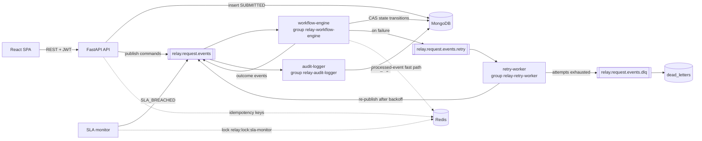
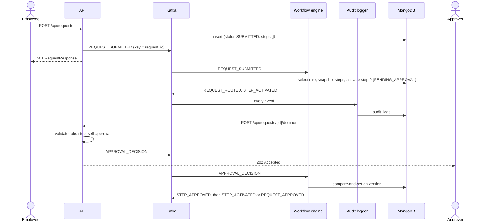

# RELAY

An event-driven approval platform. Employees submit requests (purchases, expenses, ...); a configurable workflow engine routes
each one through the right chain of approvers based on amount, department and type; every state change flows through Kafka, so
the system is auditable, replayable and resilient to failures.

- **Backend**: FastAPI, aiokafka, Motor (MongoDB), Redis, JWT auth
- **Frontend**: React 19 + Vite + Tailwind
- **Infra**: Docker Compose (MongoDB 7, Redis 7, Apache Kafka in KRaft mode, Kafka UI)

The binding API/event/data spec is [`docs/CONTRACT.md`](docs/CONTRACT.md). Design decisions are logged in
[`docs/ASSUMPTIONS.md`](docs/ASSUMPTIONS.md) and [`docs/assumptions/`](docs/assumptions/).

## Architecture



The consumers and the SLA monitor run as asyncio tasks inside the FastAPI process (`RUN_WORKERS=true`). They can also run
standalone: `uv run python -m app.workers`.

### Event flow: submit, route, approve



Decision endpoints return `202`: state changes are applied asynchronously by the consumer, so the UI refreshes/polls.

## Reliability

- **Idempotency (consumers)**: each group records `(group, event_id)` in Mongo `processed_events` (unique index) with a Redis
  fast-path key `relay:processed:{group}:{event_id}` (7 day TTL). Duplicates are skipped and committed. Decisions also validate
  `step_index == current_step`, so replays cannot double-approve.
- **Idempotency (API)**: `POST /api/requests` honours an `Idempotency-Key` header; the first response is cached in Redis for 24 h.
- **Optimistic concurrency**: every request carries a `version`; each transition is a compare-and-set.
- **Manual offset commits**: committed only after successful handling or hand-off to retry/DLQ.
- **Retries**: a failing handler publishes to `relay.request.events.retry` with `attempt+1` and exponential backoff
  (`RETRY_BACKOFF_SECONDS * 2^attempt`, up to `MAX_EVENT_RETRIES`).
- **Dead-letter queue**: exhausted events go to `relay.request.events.dlq` and Mongo `dead_letters`; an admin can replay or
  discard them (`/api/admin/dlq`). A request titled with `[fail]` deliberately fails to demonstrate this path.
- **SLA monitor**: a periodic scan guarded by the Redis lock `relay:lock:sla-monitor` (one scanner at a time) publishes
  `SLA_BREACHED`, deduplicated by `relay:sla:{request_id}:{step_index}:{escalation_level}`. The engine escalates the step to
  the configured next role.
- **Ordering**: events are keyed by `request_id`, so a request's events are ordered within a partition.

## Workflow configuration

Workflows live in the `workflows` collection (admin CRUD at `/api/workflows`). Rules are evaluated by ascending `priority`;
the first match wins. Conditions are optional and AND-ed: `min_amount` (inclusive), `max_amount` (exclusive), `departments`,
`request_types`. No match falls back to a single `MANAGER` step with a 24 h SLA. Editing a workflow bumps `version`; in-flight
requests keep the steps they were routed with.

```json
{
  "_id": "WF-DEFAULT-PURCHASE", "name": "Purchase approvals", "request_type": "PURCHASE", "active": true, "version": 1,
  "rules": [
    {"name": "Small spend",  "priority": 1, "conditions": {"max_amount": 10000},
     "steps": [{"role": "MANAGER", "sla_hours": 24}]},
    {"name": "Medium spend", "priority": 2, "conditions": {"min_amount": 10000, "max_amount": 100000},
     "steps": [{"role": "MANAGER", "sla_hours": 24}, {"role": "FINANCE", "sla_hours": 24}]},
    {"name": "Large spend",  "priority": 3, "conditions": {"min_amount": 100000},
     "steps": [{"role": "MANAGER", "sla_hours": 24}, {"role": "FINANCE", "sla_hours": 24}, {"role": "DIRECTOR", "sla_hours": 24}]}
  ],
  "escalation": {"MANAGER": "DIRECTOR", "FINANCE": "DIRECTOR", "DIRECTOR": "ADMIN", "ADMIN": null}
}
```

`sla_hours` is a float; `0.01` (about 36 s) is handy for demoing escalation.

## RBAC

Roles: `EMPLOYEE < MANAGER < FINANCE < DIRECTOR < ADMIN`.

| Capability | EMPLOYEE | MANAGER | FINANCE | DIRECTOR | ADMIN |
|---|---|---|---|---|---|
| Create request, view/cancel own | yes | yes | yes | yes | yes |
| Approvals inbox | no | yes | yes | yes | yes (all) |
| Approve / reject current step | no | if step role is mine | same | same | any |
| View any request | no | yes | yes | yes | yes |
| Audit log (all entries) | own requests only | yes | yes | yes | yes |
| Workflows CRUD, DLQ, user admin | no | no | no | no | yes |

Nobody can approve their own request (403). Public registration always creates an `EMPLOYEE`.

## Demo accounts

Seeded when `SEED_DEMO_DATA=true` (default). Password for all: `Relay@123`

| Email | Name | Role |
|---|---|---|
| employee@relay.dev | Esha Employee | EMPLOYEE |
| manager@relay.dev | Manoj Manager | MANAGER |
| finance@relay.dev | Farah Finance | FINANCE |
| director@relay.dev | Dev Director | DIRECTOR |
| admin@relay.dev | Ada Admin | ADMIN |

## Quickstart

Prerequisites: Docker, [uv](https://docs.astral.sh/uv/), Node 20+, Python 3.12.

```bash
# 1. Infra (MongoDB :27017, Redis :6379, Kafka :9092, Kafka UI :8080)
docker compose up -d            # or scripts/dev-up.sh / scripts/dev-up.ps1

# 2. Backend (http://localhost:8000, docs at /docs)
cd backend && uv run uvicorn app.main:app --reload --port 8000

# 3. Frontend (http://localhost:5173)
cd frontend && npm install && npm run dev
```

Run from `relay/`. Helper scripts in `scripts/` (each has `.sh` and `.ps1` variants): `dev-up`, `dev-down` (`-v` drops volumes),
`run-backend`, `run-frontend`, `demo-flow`.

**Full stack in containers:** `docker compose --profile app up -d --build` serves the API on :8000 and the SPA on :3000
(set `VITE_API_URL` at build time if the API lives elsewhere; the backend `SECRET_KEY` can be overridden via env).

**Demo:** with the backend running, `python scripts/demo_flow.py` logs in as each demo user, walks small/medium/large requests
through Manager, Finance and Director, rejects one, shows self-approval being blocked, and submits a `[fail]` request to show
retry then DLQ. Use `--skip-dlq` to skip the last step.

**Without Kafka:** set `EVENT_BUS=memory` to run the same semantics in-process (this is what tests use).

### Configuration

Environment variables (a `.env` in `backend/` is supported): `MONGODB_URL`, `DATABASE_NAME`, `REDIS_URL`,
`KAFKA_BOOTSTRAP_SERVERS`, `SECRET_KEY`, `ALGORITHM`, `ACCESS_TOKEN_EXPIRE_MINUTES`, `CORS_ORIGINS`, `EVENT_BUS`
(`kafka`|`memory`), `RUN_WORKERS`, `SLA_CHECK_INTERVAL_SECONDS` (15), `MAX_EVENT_RETRIES` (3), `RETRY_BACKOFF_SECONDS` (2),
`SEED_DEMO_DATA`.

## Testing

```bash
cd backend && uv run pytest -q     # 46 tests, EVENT_BUS=memory with mongomock + fakeredis; no Docker needed
cd frontend && npm run lint && npm run build
python scripts/demo_flow.py        # live end-to-end check against a running stack (real Kafka)
```

`backend/tests/` covers:
- `test_rules.py`: rule matching across the amount tiers, fallback, departments and request types.
- `test_workflow_flow.py`: the full approve chain, reject (remaining steps SKIPPED), cancel, list filters, route preview, and workflow versioning with in-flight snapshots.
- `test_auth_rbac.py`: JWT auth, role denials, self-approval block, admin-only routes, and that public sign-up creates employees only.
- `test_reliability.py`: duplicate-event idempotency, `[fail]` retry → DLQ → replay and discard, `Idempotency-Key` replay, SLA escalation through the chain and the Redis lock, audit fan-out, and the Mongo outbox.

The frontend has no automated test suite yet. It was smoke-tested against the live API with Playwright.

## Project layout

```
relay/
  docker-compose.yml     infra (+ backend/frontend under profile "app")
  backend/               FastAPI app (app/), Dockerfile
  frontend/              React + Vite SPA, Dockerfile, nginx.conf
  scripts/               dev-up, dev-down, run-backend, run-frontend, demo-flow
  docs/                  CONTRACT.md (spec), ASSUMPTIONS.md, assumptions/
```

## Status and roadmap

Phase 1 delivered JWT auth and request CRUD. Phase 2 (branch `feat/phase2-workflow-engine`) delivered everything else:
- the Kafka-based workflow engine with dynamic routing;
- SLA tracking with automated escalation;
- idempotent consumers with retry topic, DLQ and admin replay;
- a Mongo outbox fallback;
- JWT/RBAC REST APIs;
- the React UI, including the audit-log dashboard.

It was verified with the backend test suite and with live runs against real Kafka, MongoDB and Redis.

Known gaps:
- no CI pipeline;
- no frontend automated tests;
- no notifications;
- single Kafka broker with RF 1 (dev only);
- no refresh tokens (`SECRET_KEY` must come from the environment in production);
- audit summary chips count only the current page.

Ideas for later: multi-partition consumer scaling across instances, schema registry for events, notifications (email/Slack),
delegation and out-of-office routing, metrics/tracing (Prometheus, OpenTelemetry).
